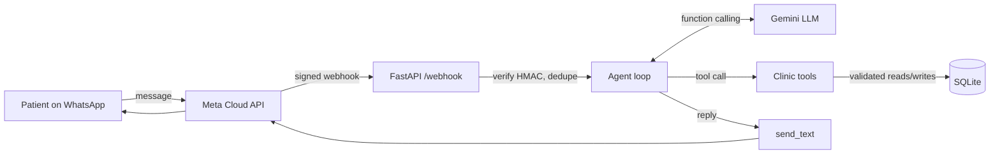

# Clinic Booking Agent — WhatsApp AI agent with tool calling

An AI agent that books, lists and cancels clinic appointments over WhatsApp, in Egyptian Arabic or English.
The LLM decides **what** to do; Python code decides **whether it's allowed**.

> Patient: عايز أحجز عند دكتورة الأسنان يوم الاتنين
> Agent checks the real schedule → offers free times → confirms the name → books → sends the confirmation.

## Why this project

Clinics in Egypt take most bookings by phone and WhatsApp, by hand. A plain chatbot can answer questions,
but booking needs an **agent**: it has to look up live availability, act on a database, and stay correct
when two patients want the same slot. This repo is that agent, built the way I'd ship it to a real clinic.

## Architecture



**Agent loop** (`app/agent.py`): send the conversation + tool schemas to the model → if it asks for tools,
run them and feed the results back → repeat until it answers in text (max 6 steps).

**Tools** (`app/tools.py`):

| Tool | What it does |
|---|---|
| `list_doctors` | Doctors, specialty, fee, working days |
| `find_available_slots` | Free times for a doctor on a date, from the real weekly schedule |
| `book_appointment` | Books a slot for the patient in this chat |
| `list_my_appointments` | The patient's upcoming bookings |
| `cancel_appointment` | Cancels one of the patient's own bookings |
| `request_human` | Hands off medical questions, complaints and emergencies to staff |

The LLM layer (`app/llm.py`) is provider-neutral: Gemini is the default (free tier), and swapping in another
model means writing one `complete()` method.

## Guardrails (enforced in code, not in the prompt)

- **Identity comes from WhatsApp, not the model.** The patient's phone number is bound to the tools for the
  session; the LLM never passes it. A message like "cancel the booking for 0100…" can't touch anyone else's data.
- **No invented times.** `book_appointment` only accepts a slot that exists in the doctor's schedule, is in the
  future, and is free.
- **No double booking, even under race conditions.** A partial unique index in SQLite rejects a second active
  booking for the same doctor and time.
- **Abuse limits:** max 2 upcoming bookings per patient, 30 messages per hour, messages capped at 1,000 characters,
  6 agent steps per turn.
- **Webhook security:** every request must carry a valid `X-Hub-Signature-256` HMAC; duplicate deliveries are
  ignored by message id.
- **Fails safe:** if the LLM errors or loops, the patient gets a polite fallback, never a stack trace.
- **Privacy in logs:** phone numbers are masked and tool arguments (names) are not logged.
- **Secrets** live in `.env` (git-ignored); the `/chat` test endpoint is off unless `DEMO_MODE=true`.

## Tests

```bash
pip install -r requirements-dev.txt
pytest
```

17 tests run offline with a scripted LLM, covering the booking flow end to end, double booking, invented and
past times, cross-patient cancellation, runaway agent loops, rate limits and forged webhooks.

## Run it

**1. Install** (Python 3.10+)

```bash
python -m venv .venv
.venv\Scripts\activate          # Windows  (macOS/Linux: source .venv/bin/activate)
pip install -r requirements.txt
copy .env.example .env          # macOS/Linux: cp .env.example .env
```

Put a free Gemini key from [Google AI Studio](https://aistudio.google.com/apikey) in `GEMINI_API_KEY`.

**2. Chat in the terminal** (no WhatsApp needed)

```bash
python chat.py
```

**3. Connect WhatsApp**

1. Create an app at [Meta for Developers](https://developers.facebook.com/) and add the WhatsApp product.
2. Copy the access token, phone number id and app secret into `.env`, and choose a `WA_VERIFY_TOKEN`.
3. Start the server and expose it:
   ```bash
   uvicorn app.main:create_app --factory --port 8000
   ngrok http 8000
   ```
4. In the WhatsApp configuration, set the webhook to `https://<your-ngrok-url>/webhook`, use your verify token,
   and subscribe to `messages`.

## Project structure

```
app/
  agent.py      agent loop + system prompt
  tools.py      tool schemas and validated business logic
  llm.py        Gemini adapter + scripted fake for tests
  db.py         SQLite schema, seed data, chat history
  whatsapp.py   signature check, payload parsing, sending
  main.py       FastAPI app (webhook, health, demo /chat)
chat.py         terminal chat
tests/          pytest suite
```

## Next steps

- Evaluation set: score the agent on real Arabic booking conversations (correct tool, correct slot, no
  hallucinated times) and track it per model.
- Reminder messages 24 hours before each appointment (WhatsApp template messages).
- Staff dashboard for handoffs; Postgres + a job queue for multi-clinic use.

---
Built by [Hesham Ashraf](https://www.linkedin.com/in/hesham-ashrf) · AI Engineer (AI agents & automation)
